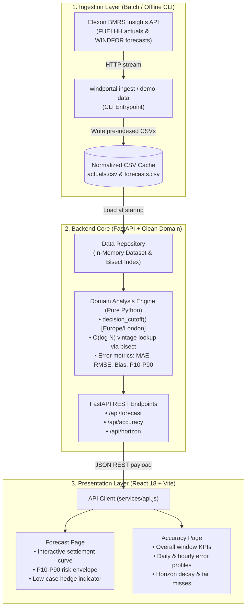

# ⚡ Wind Forecast Portal

[](https://www.python.org/)
[](https://fastapi.tiangolo.com)
[](https://react.dev/)
[](https://vitejs.dev/)
[](https://github.com/astral-sh/ruff)
[](https://pytest.org/)
[](https://opensource.org/licenses/MIT)

> **Day-ahead decision support & quantitative forecast risk analytics for GB energy utilities**, leveraging national wind generation data from Elexon BMRS (`FUELHH` actuals and `WINDFOR` published forecast vens).

---

## 📌 Table of Contents
- [Executive Overview](#-executive-overview)
- [Key Features](#-key-features)
- [System Architecture](#-system-architecture)
- [Design Decisions & Trade-Offs](#-design-decisions--trade-offs)
- [Project Structure](#-project-structure)
- [Quick Start](#-quick-start)
  - [Prerequisites](#prerequisites)
  - [Option A: Windows 1-Click Launchers (Recommended)](#option-a-windows-1-click-launchers-recommended)
  - [Option B: Manual Terminal Execution](#option-b-manual-terminal-execution)
  - [Option C: Unix / macOS (Makefile)](#option-c-unix--macos-makefile)
  - [Option D: Docker & Docker Compose](#option-d-docker--docker-compose)
- [REST API Specification](#-rest-api-specification)
- [Domain Logic & Math Formulation](#-domain-logic--math-formulation)
- [Testing & Quality Assurance](#-testing--quality-assurance)
- [Deployment Topologies](#-deployment-topologies)
- [Limitations & Engineering Roadmap](#-limitations--engineering-roadmap)

---

## 🧭 Executive Overview

Energy trading and procurement teams in the **Great Britain (GB) power market** must commit physical and financial positions at day-ahead gate closure (typically 09:00 London on $D-1$). 

A recurring flaw in naive backtests is **look-ahead bias**—evaluating day-ahead decisions against forecasts published after the decision was already executed.

**Wind Forecast Portal** solves this problem by strictly enforcing causal time boundaries:
1. **Decision Cutoff Emulation**: At decision time $T_{cutoff}$ on $D-1$, only forecast revisions published with $\text{publishTime} \le T_{cutoff}$ are selected for each of the 48 half-hour settlement periods of delivery day $D$.
2. **Empirical Tail-Risk Sizing**: Derives historical P10–P90 uncertainty intervals and calculates the explicit **downside energy hedge** needed to cover volume shortfall risks.
3. **Accuracy Benchmarking**: Quantifies systemic bias, mean absolute error (MAE), root mean square error (RMSE), and lead-time forecast degradation.

---

## 🚀 Key Features

| Capability | Technical Details |
| :--- | :--- |
| **Strict Causal Vintage Selection** | $O(\log N)$ binary search (`bisect`) per settlement period to retrieve the exact vintage visible to the trader at cutoff. Zero look-ahead leakage. |
| **Day-Ahead Forecast Inspection** | 48 Settlement Periods (HH) per day, visualizing forecast curve, actual outturn, and P10–P90 empirical error bands. |
| **Downside Risk & Hedge Sizing** | Computes Expected MWh vs Low-Case MWh ($P90$ over-forecast error) to recommend non-wind hedge volumes. |
| **Full Error KPI Suite** | Real-time calculation of MAE, RMSE, Mean Bias, nMAE (% of mean output), and MAPE (zero-filtered). |
| **Horizon Decay Analysis** | Evaluates forecast degradation from 1 to 48+ hours ahead to quantify the statistical cost of committing earlier. |
| **Timezone & DST Rigor** | DST-aware (`Europe/London` via Python `zoneinfo`) handling 46, 48, and 50 settlement period clock-change days. |

---

## 🏛 System Architecture

The application is structured following **Hexagonal / Clean Architecture** principles, decoupling external I/O from pure domain mathematics:



---

## 🧠 Design Decisions & Trade-Offs

### 1. In-Memory Bisect Index vs. Relational/Time-Series DB
* **Decision**: Pre-sort forecast vintages by target settlement start time and publication time, using Python's `bisect_right` on startup.
* **Rationale**: For fixed-window or bounded reporting scopes (e.g., January 2026, ~650 KB forecast dataset), in-memory binary search delivers sub-millisecond query responses ($< 2 \text{ms}$) with zero database connection overhead or external operational dependencies.
* **Trade-off**: For real-time streaming over multi-year windows, this would transition to TimescaleDB or ClickHouse with an index on `(start_time, publish_time)`.

### 2. Standard-Library Pure Python Math vs. Pandas/NumPy Runtime
* **Decision**: Domain metrics (`MAE`, `RMSE`, percentiles) are implemented using Python's native standard library (`math`, `statistics`).
* **Rationale**: Reduces serverless / Docker container image footprint from ~250MB down to ~35MB, drastically speeding up CI/CD pipelines, container cold starts, and Vercel serverless provisioning.

### 3. Asynchronous Non-Blocking HTTP Client
* **Decision**: `httpx` with timeout management and exponential backoff retry patterns for the Elexon API.
* **Rationale**: Resilient against network drops and Elexon BMRS rate-limiting during batch ingestion runs.

---

## 📂 Project Structure

```text
Wind-Forecast-Portal/
├── backend/
│   ├── pyproject.toml               # Poetry/PEP 621 metadata, deps, pytest & ruff configs
│   ├── Dockerfile                   # Python container image definition
│   ├── data/                        # Static datasets (actuals.csv, forecasts.csv, source.json)
│   ├── src/windportal/              # Application source root
│   │   ├── config.py                # 12-factor typed Pydantic Settings
│   │   ├── main.py                  # ASGI app factory with CORS, logging & static mounts
│   │   ├── cli.py                   # CLI tool (windportal ingest | demo-data)
│   │   ├── api/                     # HTTP Transport Layer
│   │   │   ├── routes.py            # REST route controllers
│   │   │   ├── schemas.py           # Strict Pydantic request/response schemas
│   │   │   └── deps.py              # FastAPI dependency injection providers
│   │   ├── domain/                  # Pure Business Logic (Deterministic, zero I/O)
│   │   │   ├── service.py           # Vintage resolution, hedge calculation, accuracy orchestration
│   │   │   ├── metrics.py           # Pure statistical computations (MAE, RMSE, Bias, MAPE, P10-P90)
│   │   │   └── timeutils.py         # DST-aware London timestamp conversions & cutoffs
│   │   ├── data/                    # Storage & Data Access Layer
│   │   │   ├── repository.py        # In-memory storage with bisect index
│   │   │   └── models.py            # Immutable data classes for points & series
│   │   └── ingest/                  # Data Retrieval Clients
│   │       ├── elexon.py            # Elexon BMRS Insights API stream parser
│   │       └── synthetic.py         # Offline deterministic demo generator
│   └── tests/                       # Automated test suite (20 unit & contract tests)
├── frontend/
│   ├── index.html                   # HTML5 shell
│   ├── vite.config.js               # Vite config with API reverse proxy
│   ├── package.json                 # React 18, Recharts & dev tooling
│   └── src/
│       ├── app/App.jsx              # Application state, header, navigation & tabs
│       ├── pages/
│       │   ├── DecisionPage.jsx     # View 1: Settlement curve, hedge sizing & tabular data
│       │   └── AccuracyPage.jsx     # View 2: KPI grid, diurnal errors, horizon curve & misses
│       ├── components/ui.jsx        # Reusable Card, KPI stat badges & Loading fallbacks
│       ├── services/api.js          # REST client wrapper with fetch
│       ├── styles/global.css        # Clean UI styling & responsive layout
│       └── utils/format.js          # Number, timestamp, MW/MWh formatting utilities
├── deploy/                          # Production deployment manifests
│   └── docker-compose.yml           # Two-tier setup (Nginx reverse proxy + FastAPI)
├── start-dev.bat                    # Windows 1-click batch launcher
├── start-dev.ps1                    # Windows PowerShell multi-window launcher
├── Makefile                         # GNU Make automation for lint, test, run, and ingest
└── vercel.json                      # Vercel serverless deployment specification
```

---

## ⚡ Quick Start

### Prerequisites
- **Python**: `>= 3.11` (Tested on Python 3.11, 3.12, 3.14)
- **Node.js**: `>= 18.0.0` (npm `>= 9.0`)

---

### Option A: Windows 1-Click Launchers (Recommended)

To launch both the FastAPI backend and React frontend concurrently:

- **Via File Explorer**: Double-click [`start-dev.bat`](file:///c:/Users/Ansh%20Rastogi/OneDrive/Desktop/Wind-Forcast%20Portal/start-dev.bat)
- **Via PowerShell**:
  ```powershell
  .\start-dev.ps1
  ```

---

### Option B: Manual Terminal Execution

#### Terminal 1 — Backend (Port 8000)
```powershell
cd backend
.\.venv\Scripts\uvicorn windportal.main:app --reload --port 8000
```
> *API documentation will be accessible at: [http://127.0.0.1:8000/api/docs](http://127.0.0.1:8000/api/docs)*

#### Terminal 2 — Frontend (Port 5173)
```powershell
cd frontend
npm run dev
```
> *Web Application will be accessible at: [http://localhost:5173](http://localhost:5173)*

---

### Option C: Unix / macOS (Makefile)

```bash
# 1. Install dependencies across backend and frontend
make install

# 2. Run static analysis & test suites
make lint && make test

# 3. Spin up local development services
make api       # Terminal 1: FastAPI on :8000
make ui        # Terminal 2: Vite dev server on :5173
```

---

### Option D: Docker & Docker Compose

#### Production Two-Tier Stack (Nginx + FastAPI)
```bash
docker compose -f deploy/docker-compose.yml up --build
```
Access the application at `http://localhost:8080`.

#### Single-Container Quickstart
```bash
docker compose up --build
```
Access the application at `http://localhost:8000`.

---

## 📡 REST API Specification

OpenAPI JSON and interactive Swagger documentation are served live at `/api/docs`.

| Endpoint | Method | Parameters | Description |
| :--- | :---: | :--- | :--- |
| `/api/health` | `GET` | None | Basic liveness probe. Returns `{"status": "ok"}`. |
| `/api/ready` | `GET` | None | Readiness probe verifying repository data is loaded in memory. |
| `/api/meta` | `GET` | None | Metadata on delivery window, default decision time, and dataset mode. |
| `/api/forecast` | `GET` | `delivery_date` (YYYY-MM-DD)<br>`decision_time` (HH:MM) | Returns 48 settlement periods with decision-time forecast, actuals, P10–P90 interval, and hedge energy summary. |
| `/api/accuracy` | `GET` | `decision_time` (HH:MM) | Computes overall statistical metrics (MAE, RMSE, Bias, nMAE, MAPE, P90 tail risk), daily/hourly breakdowns, error histogram, and 10 worst misses. |
| `/api/horizon` | `GET` | None | Evaluates forecast MAE and Bias as a function of lead time ($h \in [0, 48]$). |

---

## 📐 Domain Logic & Math Formulation

### 1. Error Definition
For each settlement period $t$, the error $e_t$ is defined as:
$$e_t = \hat{y}_t - y_t$$
where $\hat{y}_t$ is the forecast available at the decision cutoff, and $y_t$ is the outturn generation (`FUELHH`).
* **$e_t > 0$**: Over-forecast (volume deficit risk; utility generated less wind than expected).
* **$e_t < 0$**: Under-forecast (spill risk / surplus volume).

### 2. Performance Metrics
* **Mean Absolute Error (MAE)**:
  $$\text{MAE} = \frac{1}{N} \sum_{t=1}^N |e_t|$$
* **Root Mean Square Error (RMSE)**:
  $$\text{RMSE} = \sqrt{\frac{1}{N} \sum_{t=1}^N e_t^2}$$
* **Mean Bias Error (MBE)**:
  $$\text{Bias} = \frac{1}{N} \sum_{t=1}^N e_t$$
* **Normalized MAE (nMAE)**:
  $$\text{nMAE} = \frac{\text{MAE}}{\bar{y}} \times 100\% \quad \text{where} \quad \bar{y} = \frac{1}{N}\sum_{t=1}^N y_t$$

### 3. Downside Risk & Energy Sizing
For a day with $M$ settlement periods ($\Delta t = 0.5\,\text{h}$):
$$\text{Expected Energy (MWh)} = \sum_{t=1}^M \left(\hat{y}_t \times 0.5\right)$$
$$\text{Low-Case Energy (MWh)} = \sum_{t=1}^M \left(\max(0, \hat{y}_t - P_{90}(|e|)) \times 0.5\right)$$
$$\text{Hedge to Consider (MWh)} = \max\left(0, \text{Expected Energy} - \text{Low-Case Energy}\right)$$

---

## 🧪 Testing & Quality Assurance

The test suite enforces rigorous guarantees on domain edge cases, boundary conditions, and HTTP contract adherence:

```bash
cd backend
python -m pytest -v
```

### Test Coverage Highlights
* **Causal Vintage Invariance (`test_domain.py`)**: Tests verify that changing publication cutoffs strictly selects earlier vintages and ignores later ones.
* **DST Clock-Change Resilience (`test_domain.py`)**: Verifies 46-period (spring forward), 48-period (standard), and 50-period (fall back) day structures.
* **HTTP Error Handling (`test_api.py`)**: Verifies `400 Bad Request` for out-of-range dates and `422 Unprocessable Entity` for invalid formats.
* **Ingestion Mocking (`test_ingest.py`)**: Validates stream parsing and CSV generation without requiring outbound network requests.

```text
tests/test_api.py ........                                [ 40% ]
tests/test_domain.py ..........                           [ 90% ]
tests/test_ingest.py ..                                   [ 100% ]
======================== 20 passed in 1.48s ========================
```

---

## 🚢 Deployment Topologies

### 1. Vercel Serverless (Default Cloud Target)
Configured via [`vercel.json`](file:///c:/Users/Ansh%20Rastogi/OneDrive/Desktop/Wind-Forcast%20Portal/vercel.json):
* React SPA is bundled to `/dist` and served via Vercel Edge CDN.
* Python backend is mounted at `/api/index.py` as an AWS Lambda / Vercel Serverless Function.
* Bundled CSV datasets ensure zero database cold start latency.

### 2. Multi-Stage Docker Build
Non-root runtime container adhering to container security best practices:
```bash
docker build -t windportal:latest -f Dockerfile .
docker run -p 8000:8000 windportal:latest
```

---

## ⚠️ Limitations & Engineering Roadmap

* **Gate-Closure Assumption**: 09:00 London on $D-1$ is modeled as the default decision cutoff for day-ahead auctions (e.g., EPEX SPOT / Nord Pool). Intraday continuous trading allows rebidding closer to delivery.
* **In-Sample Uncertainty Band**: The current P10–P90 envelope is derived empirically over the evaluated month. In production, this can be upgraded to **Conformal Prediction** or **Quantile LightGBM/XGBoost** conditioned on forecast wind velocity, pressure gradients, and regional distribution.
* **National vs Regional Aggregation**: The dataset currently aggregates GB national generation. Future revisions will split out DNO / Grid Supply Point (GSP) sub-regions.

---

## 📄 License
This project is open-source under the [MIT License](file:///c:/Users/Ansh%20Rastogi/OneDrive/Desktop/Wind-Forcast%20Portal/LICENSE).
