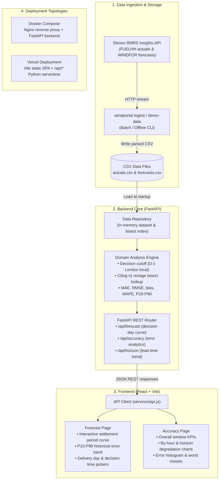

# Wind Forecast Portal (production layout)

Day-ahead decision support for a GB energy utility, using Elexon national wind data only (FUELHH actuals, WINDFOR forecasts).

1. **Forecast page**: the latest wind forecast available at the day-ahead decision time (default 09:00 London on D-1) for any delivery day, with a P10-P90 range, expected/low-case energy and actuals.
2. **Accuracy page**: quantified error of exactly that forecast over the window: MAE, RMSE, bias, nMAE, MAPE, tail errors, by day / hour / horizon, histogram, worst misses.

- Live app: `<ADD VERCEL URL>`  |  Video: `<ADD UNLISTED YOUTUBE URL>`
- **AI disclosure:** built with the assistance of an AI tool (Anthropic's Claude) for code, tests and docs; reviewed and run by the author.
- **Data note:** `backend/data/` ships with **synthetic demo data** (the UI shows a banner). Run `make ingest` to load real Elexon data before deploying or recording the video.

"Decisions made in January 2026" = decision days 1-31 Jan, so delivery days are 2 Jan - 1 Feb 2026 (`DECISION_START` / `DECISION_END`).

## Architecture



## Layout
```
backend/
  pyproject.toml            package metadata, deps, pytest + ruff config, `windportal` CLI
  Dockerfile  .env.example
  src/windportal/
    config.py               typed env settings (12-factor)
    main.py                 app factory (CORS, logging, optional static UI)
    api/    routes.py deps.py schemas.py        HTTP layer + pydantic response models
    domain/ service.py metrics.py timeutils.py  business logic (pure, no I/O)
    data/   models.py repository.py             data model, CSV loading
    ingest/ elexon.py synthetic.py              Elexon ingestion; demo-data generator
    cli.py                  `windportal ingest | demo-data`
  data/                     actuals.csv forecasts.csv source.json
  tests/                    domain, API contract, mocked ingestion
frontend/
  Dockerfile nginx.conf .env.example vite.config.js
  src/ app/App.jsx  pages/{Decision,Accuracy}Page.jsx  components/ui.jsx
       services/api.js  utils/format.js  styles/global.css
deploy/docker-compose.yml   nginx (web) -> FastAPI (api) two-service stack + ingest job
api/index.py  vercel.json   Vercel serverless entrypoint + config
Dockerfile  docker-compose.yml   single-container image (API serves the built UI)
.github/workflows/ci.yml    lint + tests + UI build + docker build
docs/                       ARCHITECTURE.md  VIDEO_SCRIPT.md  SUBMISSION_CHECKLIST.md
```

## Run
```bash
# Quick start, single container          http://localhost:8000  (API docs: /api/docs)
docker compose up --build

# Production-style, nginx + API          http://localhost:8080
docker compose -f deploy/docker-compose.yml up --build
docker compose -f deploy/docker-compose.yml --profile tools run --rm ingest   # real data, then restart api

# Local development
make install && make test && make lint
make api        # terminal 1 (:8000)
make ui         # terminal 2 (:5173, proxies /api)
make ingest     # real Elexon data (internet required)
```

## API (OpenAPI at `/api/docs`)
`GET /api/health` | `/api/ready` | `/api/meta` | `/api/forecast?delivery_date=&decision_time=` | `/api/accuracy?decision_time=` | `/api/horizon`

## Configuration (env vars, see `backend/.env.example`)
`DATA_DIR`, `DECISION_START`, `DECISION_END`, `DEFAULT_DECISION_TIME`, `MAX_HORIZON_HOURS`, `CORS_ORIGINS`, `LOG_LEVEL`, `STATIC_DIR`, `ELEXON_BASE_URL`.

## Deploy to Vercel
Import the repo (root directory, framework "Other"). `vercel.json` builds the React app and serves FastAPI as a serverless function at `/api/*`; the CSV data is bundled with it.

## Production practices
Layered architecture (api, domain, data), typed response schemas, input validation (400/404/422), liveness/readiness probes, non-root containers with healthchecks, nginx security headers and asset caching, env-driven config, CI (ruff, pytest, UI build, docker build), no look-ahead by construction (tested), DST-safe time handling (tested).

## Limitations
Gate-closure time is an assumption; the error band is in-sample and not level-conditioned; demand and price are out of scope. The Docker images and the live Elexon ingestion were not executed in the authoring environment (ingestion is tested against a mock).
