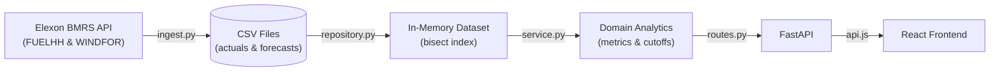

# Architecture & design notes

**Why batch ingestion to CSV?** The analysis window is fixed (January 2026), data is small (~MBs), and serving precomputed files makes the app fast, free of Elexon rate limits and trivially deployable on Vercel (read-only filesystem, no DB). A database/cron job would be the next step for a rolling window.

**Core logic (`domain/service.py`)**
- `decision_cutoff()` converts "D-1 at HH:MM London" to UTC (DST-safe via `zoneinfo`).
- `ForecastSeries.latest_at(cutoff)` uses `bisect` over sorted publish times: O(log n) per half-hour.
- `error_metrics()` is one pure function reused for the whole window, each day and each hour.
- `accuracy()` is cached per decision time; `day_forecast()` reuses it for the error band.
- Stdlib-only maths keeps the serverless bundle tiny (no pandas/numpy).

**Frontend:** two views, a thin `api.js`, no global state library; the decision time lives in `App` and is shared by both views.

**Testing:** pytest covers vintage selection (inclusive cutoff, earlier cutoff, none available), DST day lengths (46/50 periods), metric values, API contract and validation, and ingestion against a mocked API. CI runs tests and the UI build.

**Dev practices:** typed signatures, env-driven config, small pure functions, input validation (400/404), CI, Docker multi-stage build, AI-use disclosure in README.
